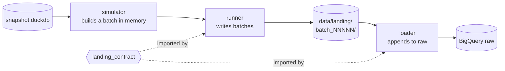

# ecom_pipeline

The Python package of [ecommerce-analytics-pipeline](../../README.md). It copies the source dataset into a frozen snapshot, replays it as daily batches of changes, lands each batch as files, and loads them into BigQuery raw. From raw onwards, the [dbt project](../../dbt/ecommerce_analytics/README.md) takes over.

How to install and run the commands is in the [project README](../../README.md#getting-started).

## Modules

| Module | Role | Command |
|---|---|---|
| `config` | Settings for every command, read once in each command's `main()` | `python -m ecom_pipeline.config` prints the values in use |
| `generator/snapshot` | Copies every table of the source dataset into a DuckDB file, with a manifest | `python -m ecom_pipeline.generator.snapshot` |
| `generator/simulator` | Builds one batch in memory from the snapshot. Pure and deterministic: reads the snapshot, writes nothing | library |
| `generator/runner` | Writes batch 0 and one batch per day to the landing zone | `python -m ecom_pipeline.generator.runner` |
| `landing_contract` | The format of landed batches, shared by the runner and the loader | library |
| `loader` | Appends finished batches to BigQuery raw and records each one | `python -m ecom_pipeline.loader` |

## How the pieces connect



The runner and the loader never call each other. They share only the files in the landing zone, so the format of those files is their whole interface, defined once in `landing_contract`. Either side can be replaced on its own: a different batch producer, or a loader for another warehouse, only has to follow the contract.

## The simulator's replay rules

The source keeps only the final state of each order, so the state on a past day has to be rebuilt from lifecycle timestamps. For a batch window `[window_start, window_end)`:

- **Windows are half-open,** in UTC. Batch 0 has no lower bound: it holds everything before the replay start. Every later batch is one day.
- **The future is hidden.** Any lifecycle timestamp at or after `window_end` is set to null (`mask_future_timestamps`), because it had not happened yet.
- **Status comes from the timestamps that remain** (`derive_status`): returned, then delivered, then shipped, then created, whichever is present first. `Cancelled` has no timestamp in the source, so it is passed through as it is.
- **A row is in a batch** if its latest remaining timestamp falls inside the window (`is_written_in_window`). It appears as one row with its state at the end of that day.
- **`_op` is `I` the first time a row appears,** in the window of its creation, and `U` in any later window (`derive_op`). Deletes are not produced yet.
- **`_source_updated_at`** is the row's latest remaining timestamp. **`_seq`** numbers the rows by key within the batch, so every rerun produces the same order.
- **Static tables** (`products`, `inventory_items`, `distribution_centers`) are delivered only in batch 0; later batches carry them empty.
- **Order items use their order's creation time,** because thelook's `order_items.created_at` is unrelated to the order.

Each batch is built from the row itself, never from earlier batches, so any batch can be rebuilt alone and every run gives the same result. Tables are built one at a time (`iter_batch_tables`), so the runner holds at most one table in memory.

## The landing contract

```
data/landing/
    batch_00063/               a finished batch: final name and a manifest inside
        orders.parquet ...     one file per table
        _manifest.json         written last
    batch_00064.tmp/           a batch being written, or left by a crash: never read
```

Every writer follows three rules:

1. Write everything into the `.tmp` folder, the manifest last, then rename the folder to its final name.
2. A folder counts as a batch only when it has a finished-batch name and holds a manifest.
3. Every table carries the metadata columns `_op`, `_source_updated_at` and `_seq`.

The manifest (`Manifest`) records the batch id, its window, the seed, and each table's file name, format, row count and size. It is validated whenever it is read, and a broken manifest in a finished-batch folder stops the reader instead of being skipped.

## The loader

- **Ingestion columns.** Each table file is appended to the raw table of the same name, with `_batch_id`, `_batch_date` (the UTC date of the window end) and `_loaded_at` added.
- **Streaming.** Files are copied in chunks of 100,000 rows, so memory stays small whatever the file size.
- **Checks.** Row counts are compared with the manifest before and after each load job. Empty tables are skipped, and only Parquet files are accepted.
- **State.** When every table of a batch is in, one row is appended to `_loaded_batches`. That table is the loader's only state: a batch listed there is not loaded again. It sits beside the data it describes, so the two can't disagree.
- **At least once.** If a run stops partway through a batch, the tables already appended stay, and the next run appends the whole batch again. The copies differ only in `_loaded_at`, and dbt staging keeps one row per key and batch. BigQuery's free sandbox allows no deletes, so a partial load can't be undone in raw; removing copies downstream is how managed loaders handle the same problem.

## Configuration

`Settings` (in `config.py`) reads each value from the first place that has it: a keyword argument, an environment variable of the same name, the `.env` file in the repo root, then the default. Relative paths are resolved from the repo root, so commands behave the same from any folder.

| Setting | Environment variable | Default |
|---|---|---|
| `app_env` | `APP_ENV` | `dev` |
| `gcp_project` | `GCP_PROJECT` | none; required by the snapshot and the loader |
| `gcp_location` | `GCP_LOCATION` | `US` |
| `source_dataset` | `SOURCE_DATASET` | `bigquery-public-data.thelook_ecommerce` |
| `raw_dataset` | `RAW_DATASET` | `ecommerce_raw` |
| `duckdb_path` | `DUCKDB_PATH` | `data/snapshot.duckdb` |
| `landing_dir` | `LANDING_DIR` | `data/landing` |

Credentials are not settings. Google's libraries find them through Application Default Credentials: your `gcloud` login locally, workload identity in CI.

## Tests

```bash
uv run pytest
```

| File | Covers |
|---|---|
| `tests/conftest.py` | an in-memory DuckDB snapshot with the source schema, and small hand-made tables |
| `tests/simulator/` | windows, masking, status, `_op`, `_source_updated_at`, reading the snapshot, and the structure of a batch |
| `tests/test_landing_contract.py` | folder names, the three writer rules, and manifest validation |
| `tests/test_loader.py` | loading, skipping loaded batches, reruns after a failure, row-count checks and chunked copying, against a fake BigQuery client |

## Planned improvements

These are the next steps for the package. Each is a good place to build on it.

**Memory and speed**
- Read only the rows a window can need, with a filter in the DuckDB query, keeping the masking and status rules in step. Today every batch reads each table in full, so one runner needs about 4 GB.
- Build batch 0 in chunks instead of whole tables in memory.
- Remove the extra copies pandas makes while masking and filtering, then compare pandas with Polars or Dask on the same batches.

**Loader**
- A catch-up mode: group pending batches into chunks, load each table once per chunk and the chunk's markers in one job. A backfill or a restore of raw then takes minutes instead of a day, and stays far inside BigQuery's limit of 1,500 load jobs per table per day.
- Skip a table whose rows for the batch are already in raw, so reruns stop creating copies.
- Retries with backoff for temporary BigQuery errors.
- Detect schema changes between a batch and its raw table before loading.
- Other targets and file formats behind the same contract.

**Runner**
- A lock file in the landing zone, so a second runner stops at once instead of colliding with the first.
- Scheduled daily runs: cron, launchd or Task Scheduler on the machine that holds the snapshot.

**Snapshot**
- Stream large tables in chunks, record each finished table so an interrupted copy resumes, and copy into a staging table that replaces the live one in one step.

**Realistic source behaviour.** The simulator replays clean data. These scenarios are planned, each with a dbt test that catches it:
- delete events: removed orders, customer erasure requests;
- late-arriving rows, and duplicate or out-of-order deliveries;
- missing or partial batches, and delivery outages that trip freshness checks;
- schema drift: new, renamed, retyped or dropped columns;
- dirty values: nulls, bad emails, negative prices, unknown statuses, orphan keys;
- volume anomalies: a promotion spike, a tracking outage;
- reference data changes, such as product price or customer address changes, to drive Type 2 dimensions;
- one scenario file that switches these on with rates and the seed, so each scenario is reproducible. The seed is already recorded in every manifest for this purpose.

**Beyond replay**
- A generator mode that produces new synthetic data instead of replaying the snapshot, behind the same landing contract.
- Packaging the simulator as a library others can use for practice data.
- A real change-data-capture source instead of the simulator: an operational database whose changes stream through a CDC tool and a message queue into the landing zone.